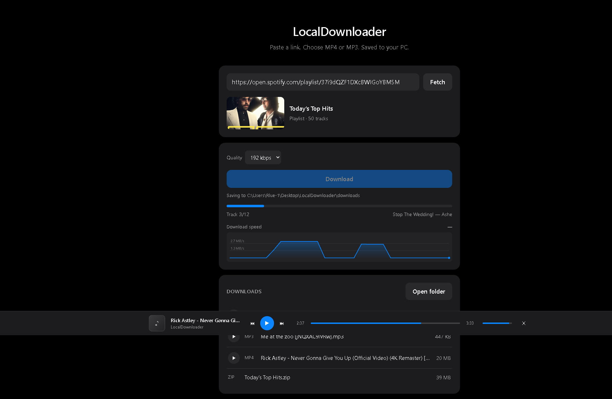

# LocalDownloader

A simple local app for downloading videos as **MP4** or extracting audio as **MP3**.
Runs entirely on your own machine — no ads, no telemetry, nothing uploaded anywhere.



## Features

- **MP4 video** — Best / 1080p / 720p / 480p / 360p
- **MP3 audio** — 320 / 256 / 192 / 128 kbps via ffmpeg
- **Live speed graph** — watch the download speed in real time
- **Built-in player** — play MP3s in the sticky bottom bar (seek, volume,
  prev/next, media keys) and MP4s in a centered video player; every download
  gets a one-click play button
- **Spotify playlists & albums** — paste a Spotify link and it downloads every
  track as MP3 into a folder, then zips it up (track list is read from Spotify,
  audio is pulled from YouTube via yt-dlp)
- **Choose where to save** — a native folder picker opens on every download
- **Live progress** — percentage, speed and ETA while downloading
  (per-track progress for playlists)
- **Show in folder** — jump straight to the finished file in Explorer
- **Remembers your last folder** — the picker opens where you saved last time
- **Download list** — everything saved to the app folder, with one-click open
- Works with **YouTube, TikTok, Instagram, X/Twitter** and 1000+ other sites (via [yt-dlp](https://github.com/yt-dlp/yt-dlp))

## Requirements

- Windows with **Python 3.10+**
- **ffmpeg** on PATH (used for merging and MP3 conversion)
- Python packages: `pip install -r requirements.txt`

## Usage

```bash
pip install -r requirements.txt
python app.py
```

Then open **http://127.0.0.1:7331** in your browser.

Or double-click **`Launch LocalDownloader.bat`** — it starts the server and
opens the page for you. A `LocalDownloader.lnk` shortcut can be placed on the
Desktop for one-click access.

### Flow

1. Paste a link → **Fetch** (shows title, thumbnail, channel, duration)
2. Pick **MP4** or **MP3** and a quality
3. **Download** → choose a save folder in the dialog
4. Watch the progress bar → **Show in folder** when it's done

For **Spotify** links the MP4/MP3 toggle disappears (tracks are always MP3).
You get a folder with numbered tracks (`01 - Artist - Title.mp3`) plus a
`.zip` of the whole playlist next to it.

## Project layout

```
LocalDownloader/
├── app.py                 # FastAPI server + yt-dlp engine
├── static/index.html      # Single-page UI (no build step, no frameworks)
├── downloads/             # Default save location
├── Launch LocalDownloader.bat
├── requirements.txt
└── README.md
```

## Notes

- The server binds to `127.0.0.1` only — it is never reachable from the network.
- Spotify support reads the public track list from Spotify's embed page — no
  account or API key needed. Private playlists are not accessible.
- Some Instagram/X posts require being logged in; if a link fails, open it in
  your browser first.
- Playlists on other sites are not supported — paste a single video link.

## Disclaimer

Only download content you have the right to download. Respect the terms of
service of the platforms you use and the rights of content creators.

## Credits

Built on [yt-dlp](https://github.com/yt-dlp/yt-dlp), [FastAPI](https://fastapi.tiangolo.com/) and [ffmpeg](https://ffmpeg.org/).
